# Cipher 1024

A small experimental / educational project that combines a pack of 1,024 pixel art symbols with a custom Python visual encryption workbench.

[Project page and downloads](https://projecta2b.itch.io/cipher-1024) · [GitHub repository](https://github.com/ProjectA2B/cipher-1024)

[Setup](#setup-and-requirements) · [Math and symbols](#1024-little-symbols-an-enormous-number-of-ways-to-arrange-them) · [Features](#what-is-this) · [Security note](#security-note) · [License](#license)

## License

- **Artwork:** The artwork is 100% free to use in your own projects however you wish, just please do not reupload or resell the artwork pack itself anywhere.
- **Code:** The code is separately available under the MIT License, allowing use, modification, redistribution and commercial use, provided its copyright and license notice are retained.

Read the [MIT code license](LICENSE-CODE-MIT.txt), [artwork use terms](LICENSE-ARTWORK.txt), and [license overview](LICENSE.txt). The MIT License applies to the code; it does not replace the artwork terms.

The original license overview retains references to `cipher_engine.py` and a bundled public demo Legend. This package uses `cipher_engine_v2.py` and intentionally includes no Legend keyfile or demo-Legend note. The source and license files are preserved unchanged.

## Setup and requirements

1. Download and extract this repository, or download the workbench release from [itch.io](https://projecta2b.itch.io/cipher-1024).
2. Keep `cipher_engine_v2.py`, the manifest and all eight glyph folders together. Install Python with Tkinter, then open a terminal in that folder.
3. Run the v2 workbench:

```sh
python cipher_engine_v2.py
```

- Tested on 64-bit Windows. macOS and Linux are untested.
- Python 3.13 recommended; tested with Python 3.13.5.
- Tkinter with Tcl/Tk 8.6 or newer. No third-party pip packages required.
- CPU-based processing; no dedicated graphics card required.
- Minimum RAM has not been benchmarked. To be conservative, 8+ GB of RAM is recommended.
- Allow additional disk space for generated files.

The v2 workbench uses **Protocol V5** and accepts the same **Legend V3** keyfiles. Existing **Protocol V4 ciphertext requires the v1 script**. Newly generated Legends default to **210,000 PBKDF2 iterations**; loaded Legends retain their stored iteration setting.

On first launch, choose to create a new Legend or select an existing private one. No Legend keyfile is included in this repository package. Back up your Legend and passphrase privately; keep them out of public uploads.

Python is only needed for the workbench, not for using the PNG artwork.

I'd advise against adjusting the limits in SafetyConfig any higher than they're set by default; large jobs will eat up RAM quickly. This tool is meant for fairly small files.

## 1,024 little symbols. An enormous number of ways to arrange them.

Each symbol has a unique four-letter codename, made from 16 onsets, 4 vowels and 16 endings. That gives 16 × 4 × 16 = 1,024 names. Ten binary choices can identify one of those symbols; that is a count of labels, not a security rating.

[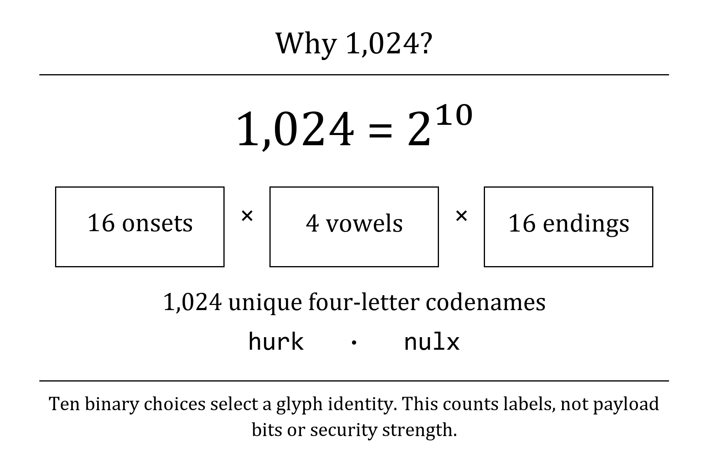](images/math/06_1a_why_1024.png)

Each symbol is only 16 × 16 pixels. A 32 × 32 grid can hold 1,024 glyphs in a 512 × 512 image. The decoder reads those tiles back into an encoded sequence, then checks and decodes the message. Some tiles carry framing, checks and padding, so 1,024 tiles does not mean 1,024 letters.

[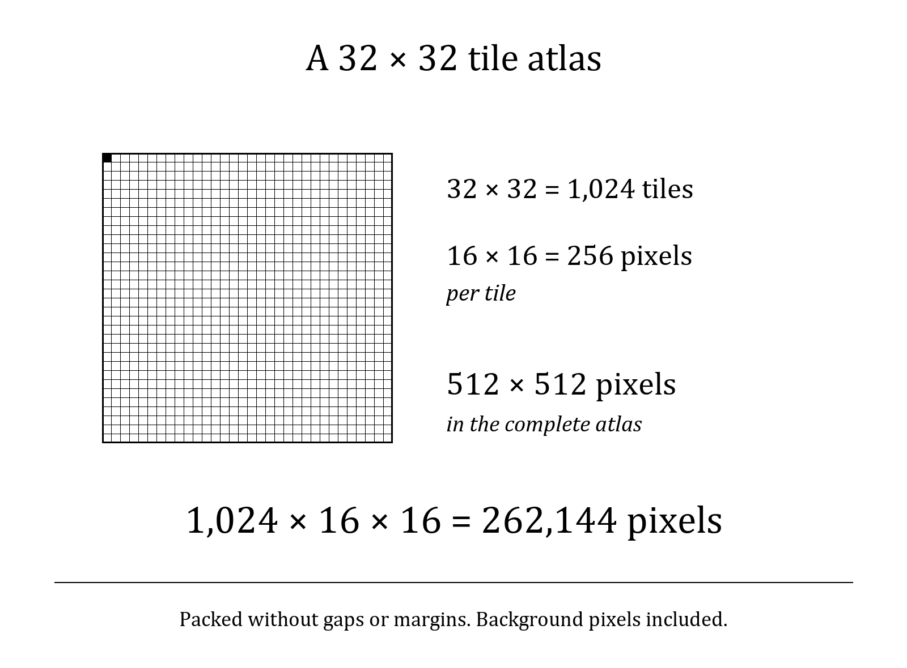](images/math/04_pixel_geometry.png)

There is another 1,024 inside each symbol: 16 × 16 pixels × 4 RGBA channels = 1,024 channel values. Across the whole atlas, that is 1,048,576 raw RGBA bytes. This counts decoded pixel data, not the compressed PNG file size.

[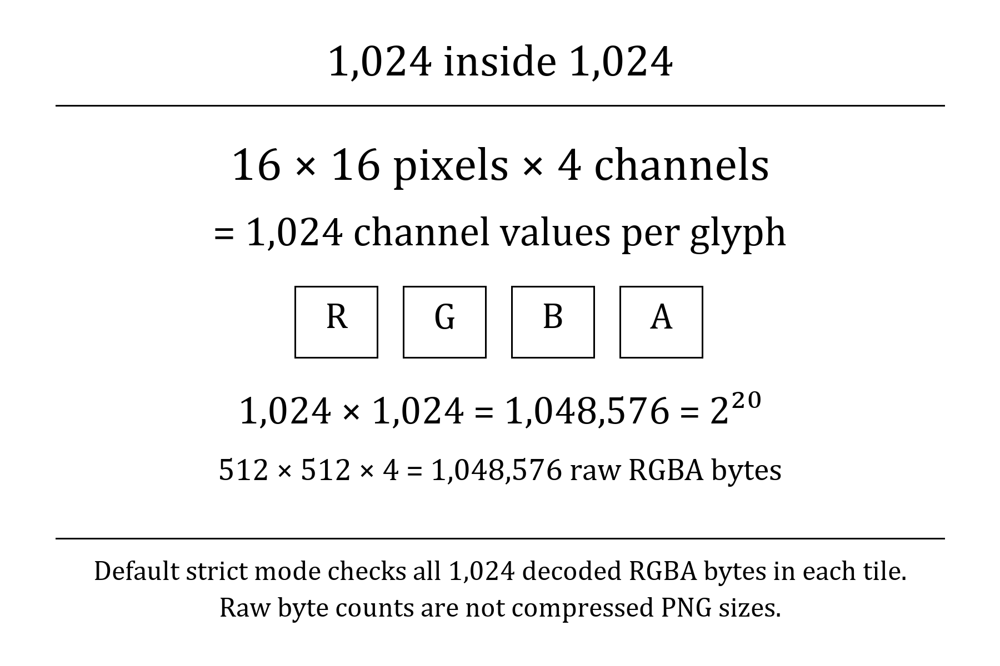](images/math/07_1b_rgba_values.png)

### Arrangements

A deck of 52 cards is a smaller warm-up for the same arrangement question.

[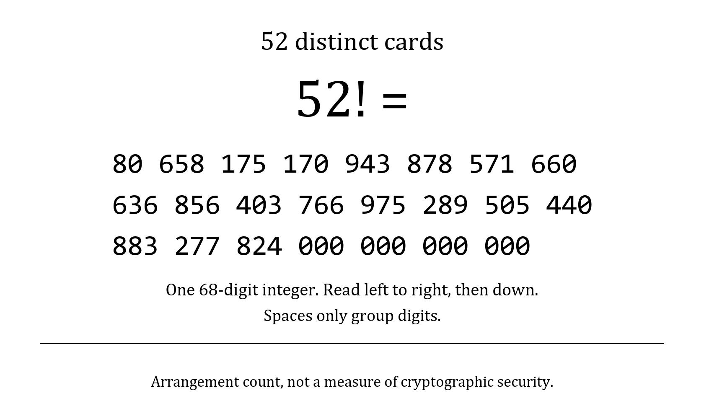](images/math/02_exact_52_factorial.png)

Imagine placing the 1,024 symbols in a row. You have 1,024 choices for the first position, 1,023 for the next, then 1,022, and so on. Multiplying those choices gives 1024!.

[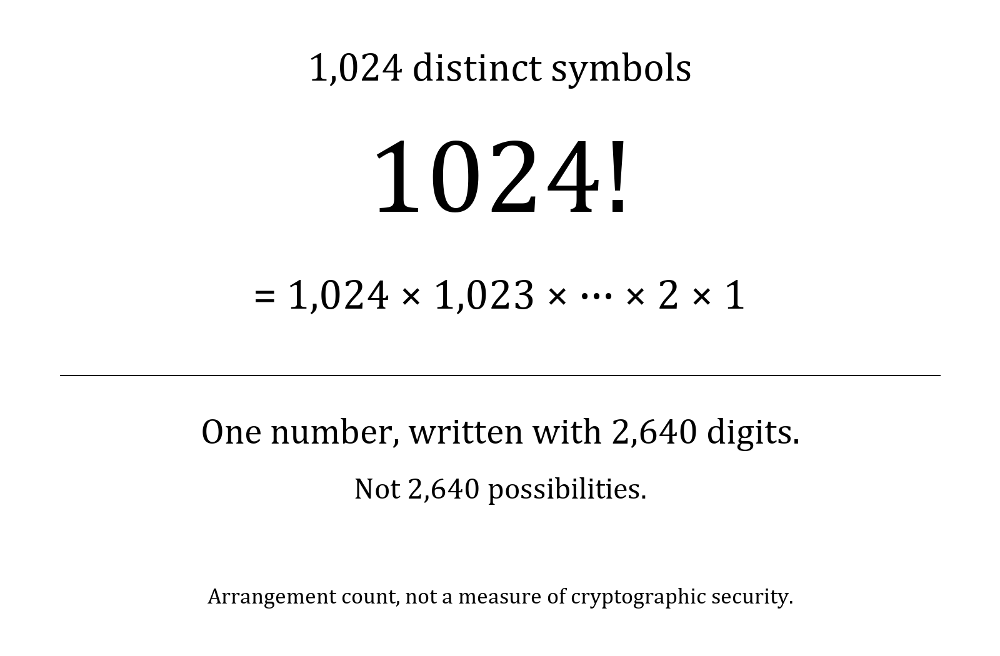](images/math/01_arrangements.png)

That giant block of digits is ONE number: the number of possible orders for these symbols. Your Legend stores one such order, which helps determine their roles in the engine. Just reading the number aloud one digit per second would take 44 minutes!

[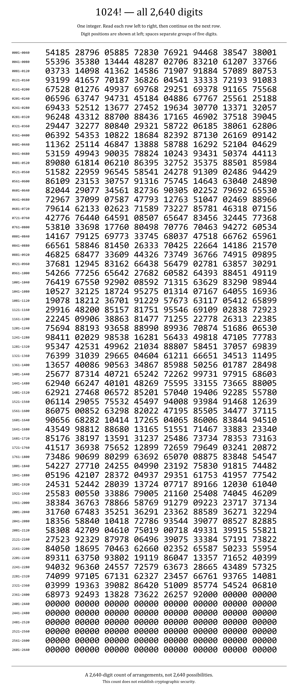](images/math/05_full_1024_factorial.png)

[Open the full-resolution digit wall to zoom in.](images/math/05_full_1024_factorial.png)

Logarithms let us count those digits without writing the whole number out. The factorial has 2,640 decimal digits, and its base-two logarithm is about 8,769.0061. Those are descriptions of the arrangement count, not a measured security level.

[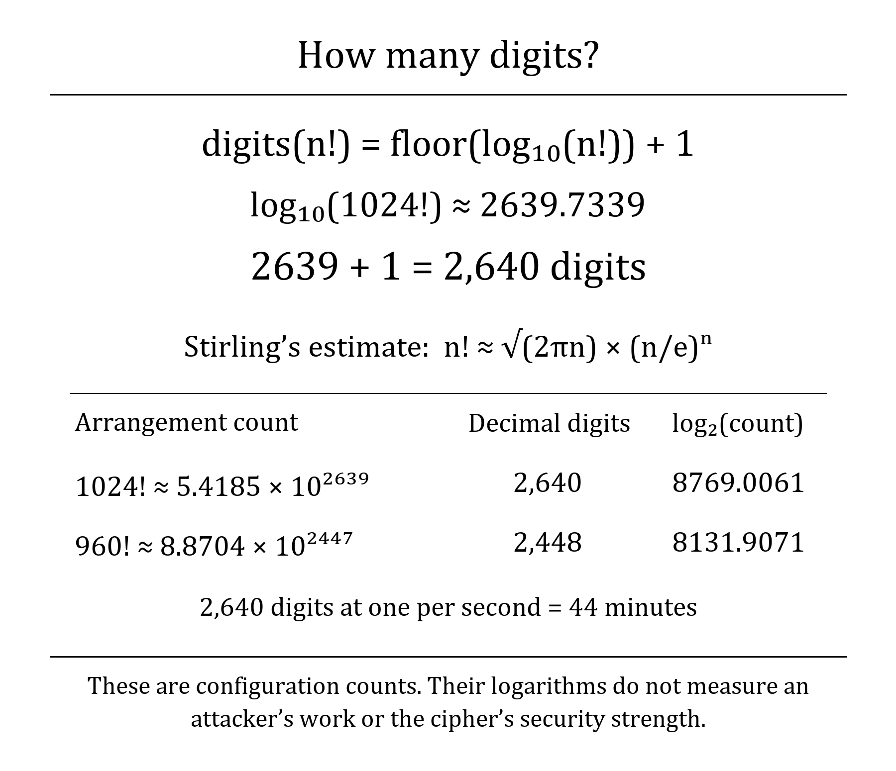](images/math/08_2a_factorial_digits.png)

### Randomness

Each encryption draws a fresh random starting value, called a nonce, from:

340,282,366,920,938,463,463,374,607,431,768,211,456 possible values.

[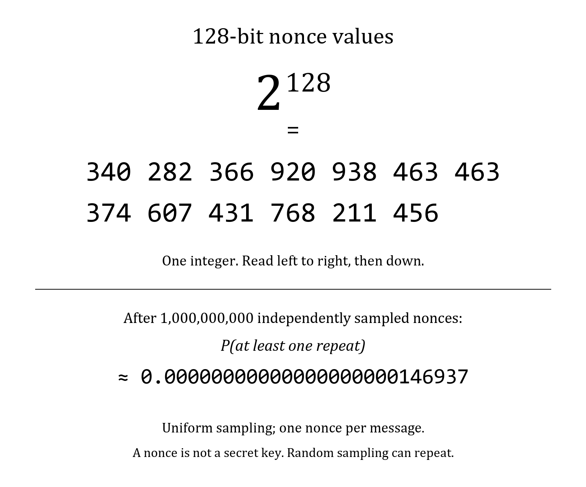](images/math/03_exact_128_bit_space.png)

The engine uses it with your secrets to derive separate session keys and rearrange the working symbol table. Try encrypting the same message twice with the same Legend and passphrase: you’ll normally get different glyph streams, yet both decode to the same original message. Random values can repeat, so uniqueness isn’t guaranteed.

The birthday calculation asks when any pair of draws might match. Under independent, uniform sampling, the approximate 50% point for a 128-bit nonce is 2.17194 × 10^19 draws. It is an illustration of random sampling, not a recommended message limit.

[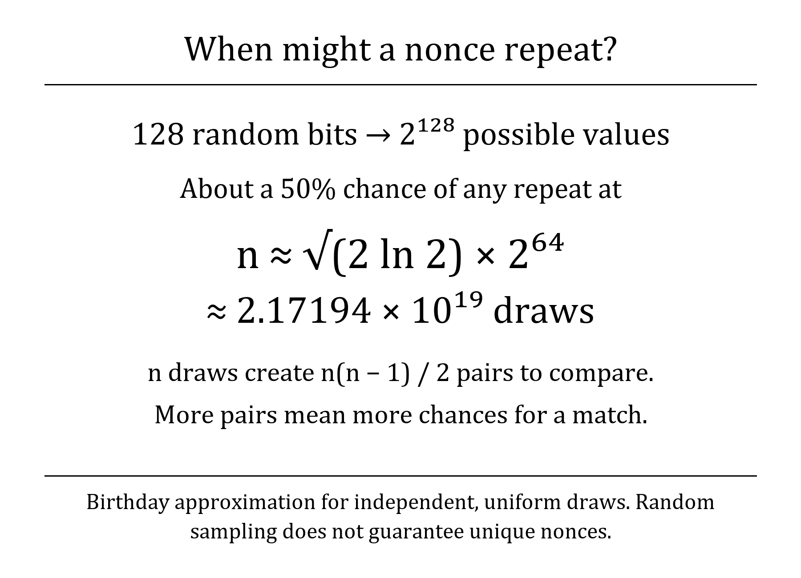](images/math/09_3a_nonce_birthday.png)

### One byte, several symbols

The engine first compresses and transforms your message. Its 960 data positions give each possible ciphertext or tag byte three or four symbol positions, and the working table changes as encoding progresses. You can explore a system where a letter doesn’t simply have one permanent replacement symbol. Slot choices can repeat, and these counts alone do not establish frequency flattening or cryptographic security.

[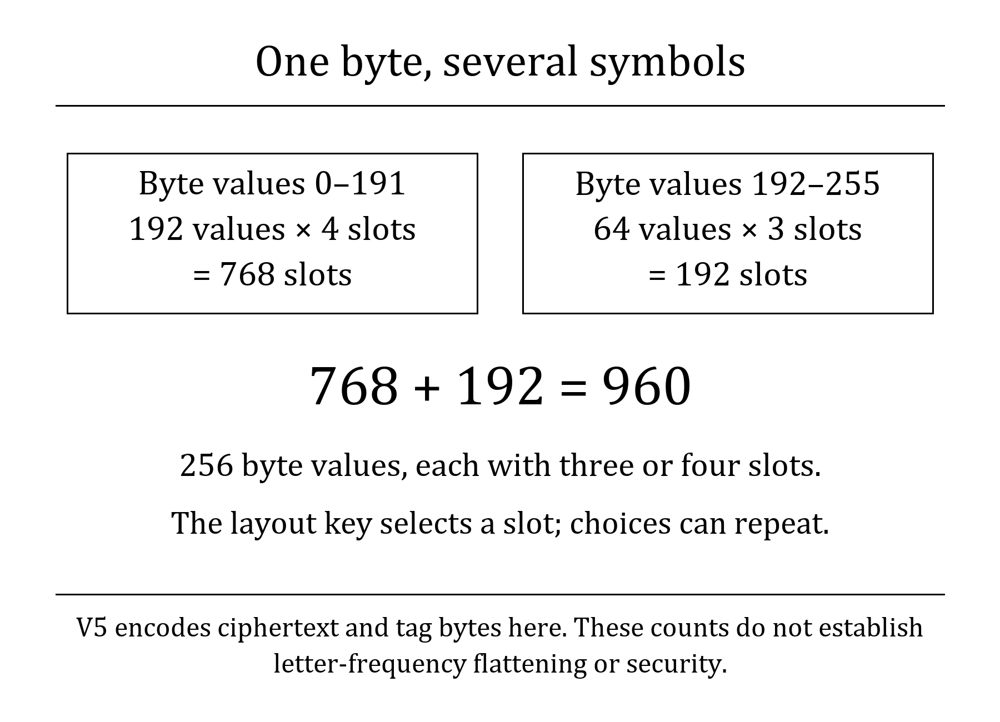](images/math/11_4b_byte_homophones.png)

These numbers describe arrangements and encoding behavior. They do not establish cryptographic security strength or how much work an attacker would need to break the system.

## What is this?

True 1,024-Glyph Visual Alphabet: Includes 1,024 unique 16x16 pixel-art glyphs across 8 visual families (plus a deterministic 1,024-glyph procedural fallback synthesizer and asset repair tool).

### Two-Secret Key Derivation & Session Transform

Legend Keyfile + Passphrase

- **Input 1 (.legend.json Keyfile):** Stores one permutation of 1,024 glyphs chosen from 1,024! possible arrangements (approx. 5.42 × 10^2639 possible orderings, or ~8,769 bits of permutation state), 16 rotor strides (coprime to both 960 and 1,007), and a 256-bit (32-byte) genesis salt, condensed via SHA-512. For a fixed set of 960 data glyphs, 960! is approx. 8.87 × 10^2447 possible orders, or ~8,132 bits of permutation state. These factorial counts describe possible arrangements, not independent amounts of secret entropy or proven cryptographic security strength.

- **Input 2 (Passphrase) & Per-Message Nonce:** PBKDF2-HMAC-SHA512 combines the passphrase and Legend digest to derive a 512-bit master-key output. Newly generated Legends default to 210,000 iterations; loaded Legends retain their stored iteration setting. Labeled HMAC-SHA256 derivations produce separate genesis-table, nonce-mask and session-root keys. Each message independently samples a random 128-bit (16-byte) nonce via secrets.token_bytes(16), derives a session secret from the session root and nonce, then derives separate encryption, authentication and layout keys. The encryption key drives the custom SHAKE-256-based stream transform.

[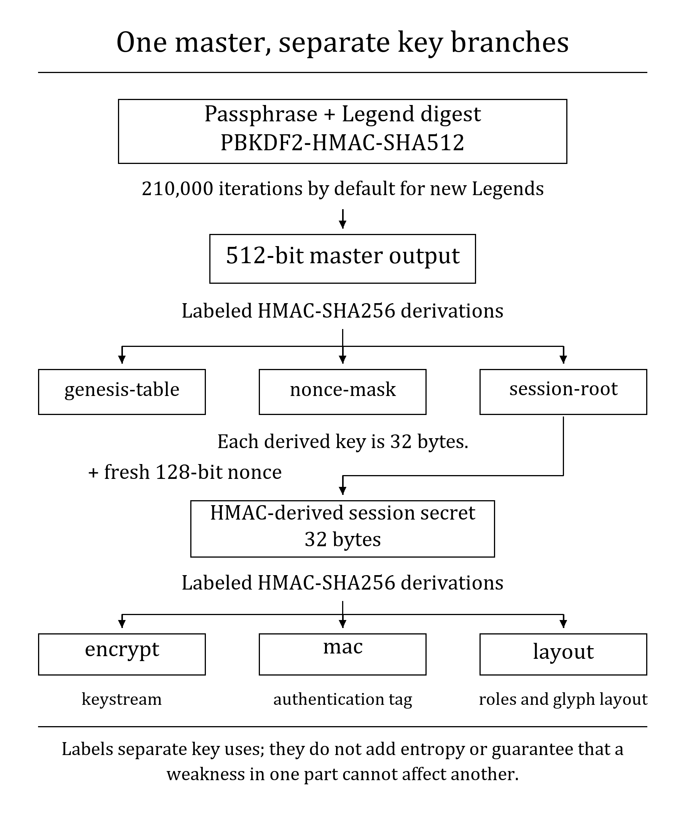](images/math/15_7a_key_tree.png)

The passphrase generator chooses eight symbol names and adds six random bytes, displayed as twelve hexadecimal characters. With independent, uniform random choices, that gives 80 + 48 = 128 bits of generated choices. Fixed separators and the final exclamation mark add no randomness. This describes the generator, not a passphrase someone chooses by hand or the security strength of the whole system.

[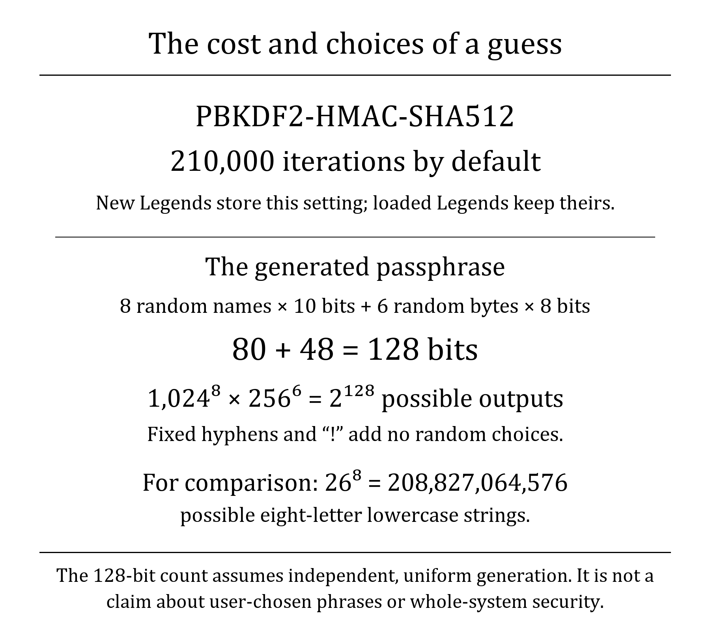](images/math/16_7b_passphrase_choices.png)

### Per-Session Role Permutation & Rotor Stepping

All 1,024 glyphs (960 Data Homophones, 16 Poly-Null Chaff, 16 Rotor Mutators, 15 Framing Decoys, 16 Visual Seal Symbols, and 1 End-Of-Frame Sigil) have session-derived assignments. The 1,007 active body/chaff/rotor/framing slots are dynamically swapped during encoding. EOF and the 16-symbol seal pool sit outside that working table. Key-derived chaff and pre-EOF bucket/jitter padding vary output lengths, though total output size still leaks approximate message size.

[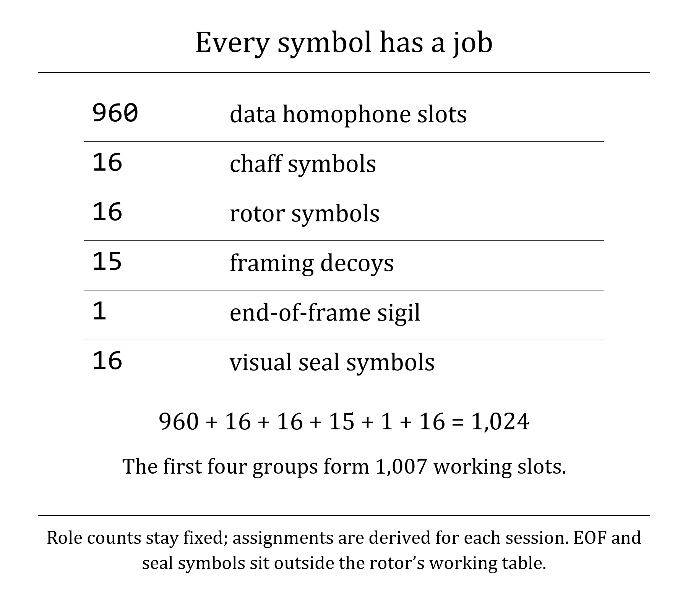](images/math/10_4a_symbol_roles.png)

Each rotor update makes 32 pair swaps in that working table. Newly generated Legends choose their 16 stored strides from 24 prime options coprime to both 960 and 1,007; repeats are allowed. The clocks below illustrate the full-cycle property of repeated fixed steps. The actual rotor does 32 swaps per update, not a complete walk around its table.

[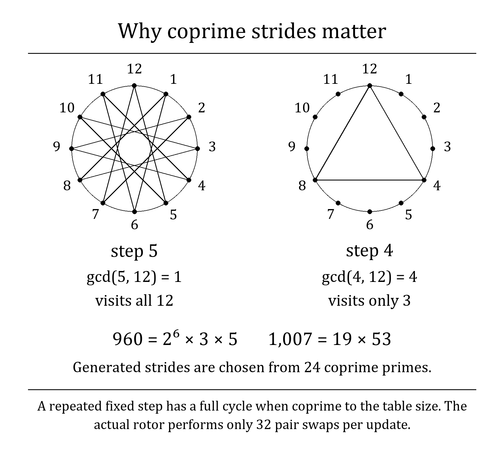](images/math/12_5a_coprime_strides.png)

## Integrity and tamper detection — Protocol V5

### Full 256-Bit HMAC-SHA256 Authentication, Encrypt-Then-MAC

The engine compresses the message, prepends a canonical 24-byte frame header, and encrypts that framed payload with its SHAKE-256-based XOR transform. HMAC-SHA256 authenticates the V5 schema identifier, a zero-byte separator, the 128-bit nonce and the resulting ciphertext. The decoder verifies this tag before decrypting the framed payload, then validates the header, geometry and exact glyph schedule before message-payload decompression. When decoding a PNG scroll, the PNG image container is first validated and decompressed under configured safety limits to recover the glyph sequence.

[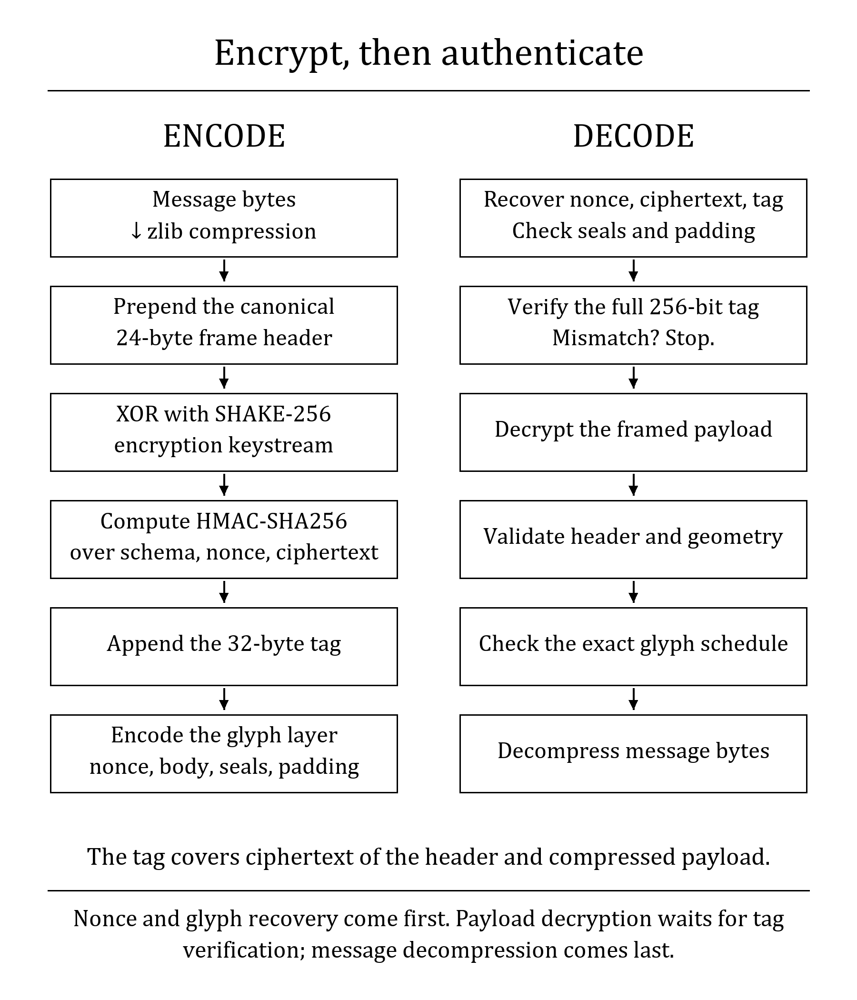](images/math/13_6a_encode_decode.png)

### 32-Bit (8-Glyph) Visual Stream Seal + Checked Grid Padding

Eight symbols from a 16-symbol pool encode the first 32 bits of a layout-keyed HMAC over the glyph sequence preceding the seals. The decoder checks this seal and session-derived trailing padding, verifies the full authentication tag, and reconstructs the exact body chaff/rotor/homophone schedule. These checks use hmac.compare_digest where comparing authentication values and expected sequences. The short visual seal does not replace the full 256-bit tag.

[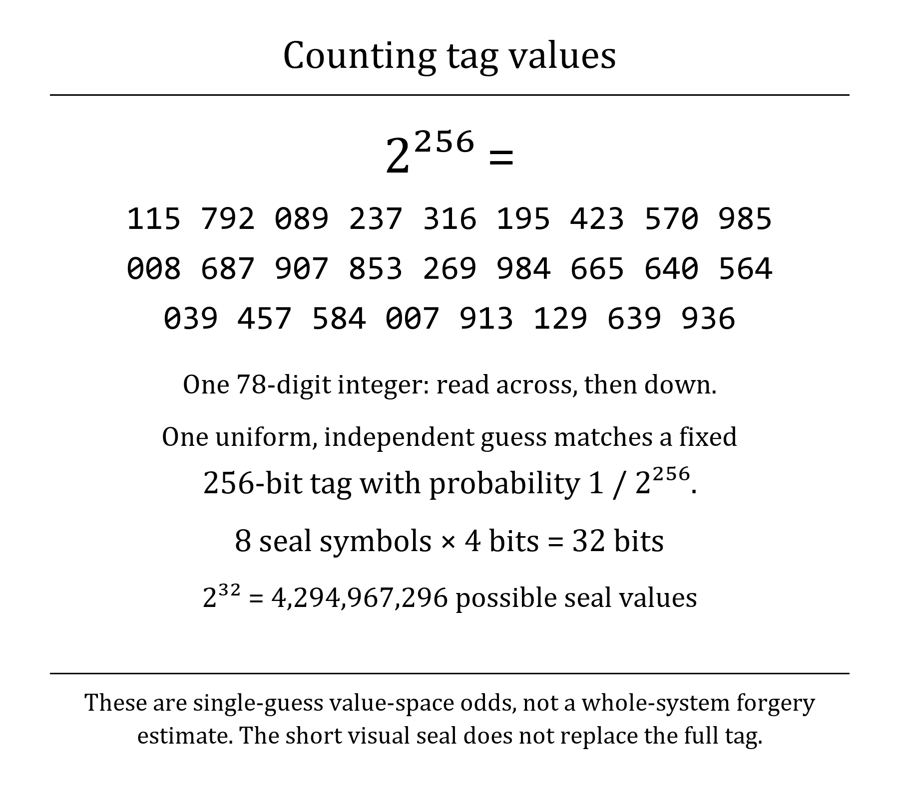](images/math/14_6b_tags_and_seals.png)

### Default Strict 16x16 RGBA Tile Verification

In default strict mode, each decoded 16x16 RGBA tile must exactly match the loaded 1,024-glyph library. Unrecognized tile pixels are rejected; changes that produce another valid glyph are checked by sequence authentication. This checks decoded tile pixels rather than non-pixel PNG container metadata.

## What these numbers mean

[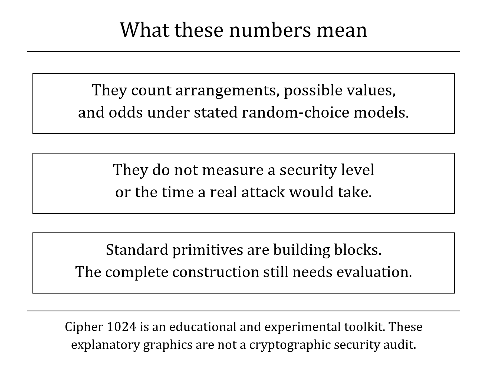](images/math/17_8_what_numbers_mean.png)

## Security note

Security depends on keeping your secrets private. Do not ship a private .legend.json keyfile inside a public release archive — generate a fresh Legend locally on first launch or via Tab 3. If a .legend.json keyfile is shared publicly (for example, inside a distributed game build), the symbol permutation is known to anyone with that build, and security against offline guessing depends on the entropy of the passphrase stretched through PBKDF2-HMAC-SHA512. While Cipher Engine 1024 uses standard Python cryptographic primitives (hashlib SHA-512, SHAKE-256, PBKDF2, and hmac SHA-256), it is an educational and game/ARG toolkit rather than a replacement for standard AEAD implementations, such as libraries providing AES-GCM or ChaCha20-Poly1305, when protecting high-value real-world secrets.
